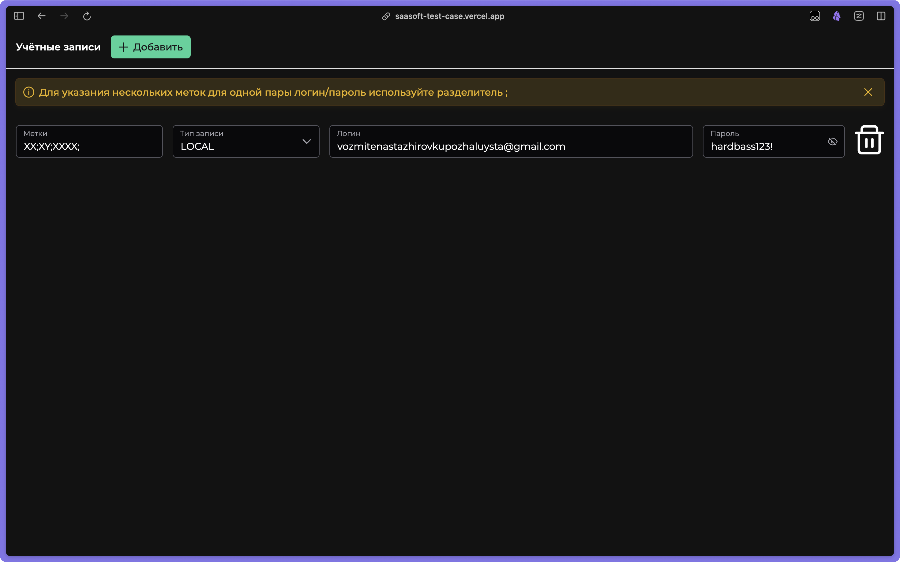

# Account manager

A small Vue app for keeping accounts: create, edit, delete, tag, and switch between LOCAL and LDAP account types. Written as a test task for a company, and the demo is public.

**Demo:** https://saasoft-test-case.vercel.app/



## What it does

- Two account types, LOCAL and LDAP, with different fields for each.
- Labels per account, validated before they are saved.
- Login and password stored with the account.
- Delete asks for confirmation.
- Everything persists in localStorage, so the demo survives a reload without a backend.
- Layout holds up on a narrow screen.

## Stack

Vue 3.5, TypeScript 5.8, Pinia, PrimeVue 4, PrimeFlex, PrimeIcons, Vite, ESLint and Prettier.

## Run

```bash
yarn install
yarn dev
```

Build with `yarn build`, lint with `yarn lint`.

## Structure

```
src/
├── assets/
├── components/     forms, table, modals
├── stores/         Pinia store with persistence
└── types/
```

## License

MIT, see [LICENSE](LICENSE).
